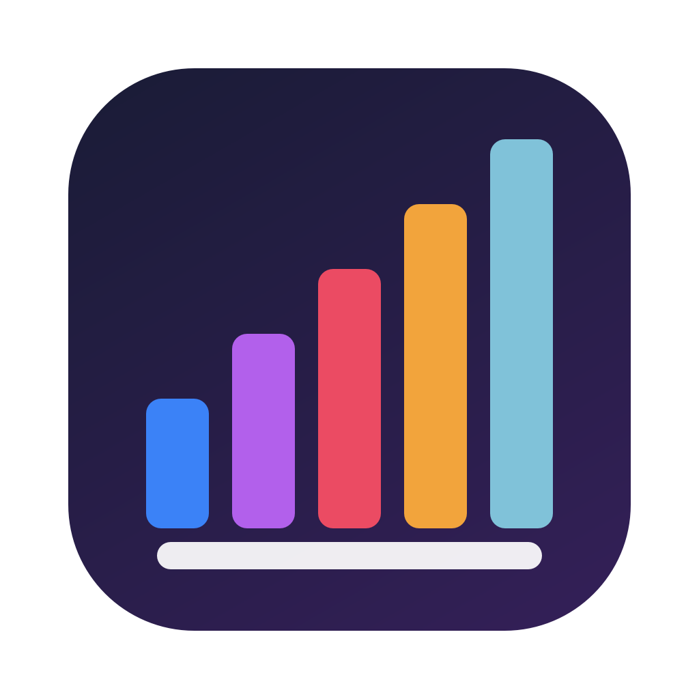
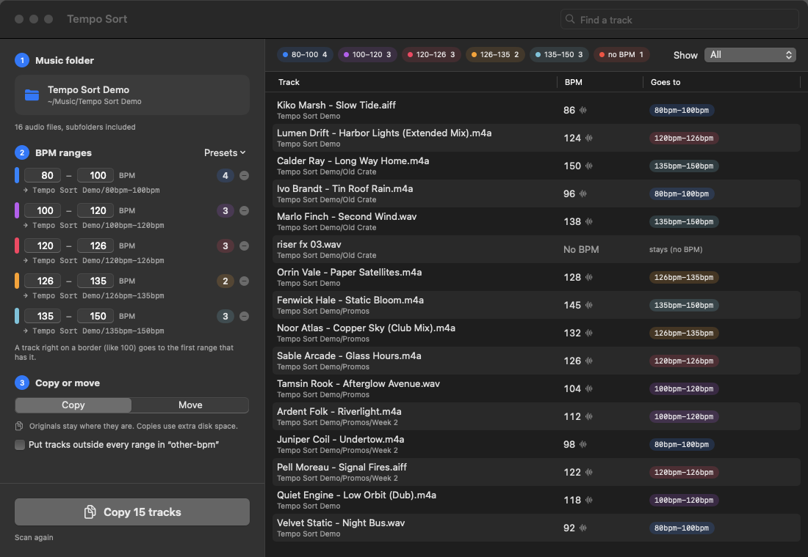
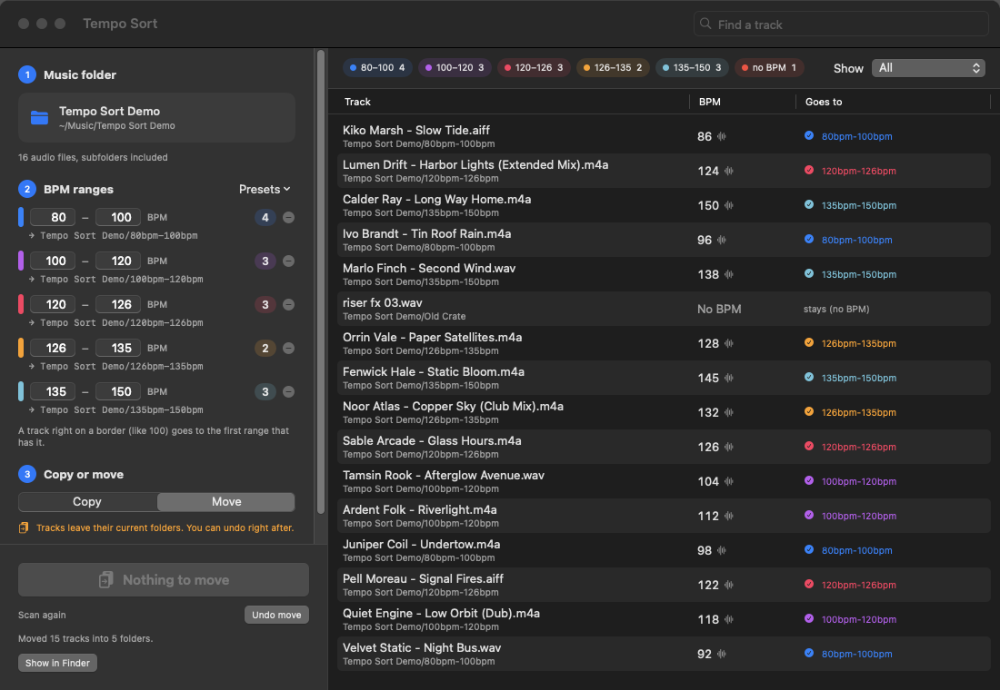

<p align="center"></p>

# Tempo Sort

A free Mac app that sorts your music into folders by BPM.

Pick a music folder. Tempo Sort finds the BPM of every track in it and in all its subfolders, then copies or moves each track into a folder for its tempo range, like `Music/Tracks/80bpm-100bpm`.



## Download

**[Download the latest DMG](https://github.com/TechnAudioToolz/tempo-sort/releases/latest)**: open it and drag Tempo Sort onto Applications.

Also on **[Gumroad](https://kevburns.gumroad.com/l/temposort)**: pay what you want, $0 is fine. Tips keep new tools coming.

Needs macOS 14 Sonoma or newer, on Apple Silicon or Intel. Works fully offline.

The app isn't registered with Apple yet, so the first time macOS may refuse to open it. Go to **System Settings → Privacy & Security**, scroll down and click **Open Anyway**. You only need to do this once.

## How it works

1. **Choose a music folder**, or drop one on the window. Subfolders are always included.
2. **Set 2 to 5 BPM ranges**, or pick a preset (hip-hop and R&B, house and techno, open format, workout). Each range becomes a folder named like `120bpm-126bpm`.
3. **Choose Copy or Move**, then click **Find BPMs**. Check the list, then click **Copy** or **Move**.



- **BPM tags first.** If a file already has a BPM tag (from Rekordbox, Serato, Traktor, Mixed In Key or your store), that's used. Otherwise the tempo is detected from the audio.
- **Remembers results**, so scanning the same folder again is instant.
- **Never overwrites.** If a name is taken, the file gets " (2)". Copy checks for free disk space first and skips files it already copied.
- **Undo** right after a sort: moves go back where they were, copies go to the Trash.
- **Borders:** a track exactly on a shared border (100 with 80–100 and 100–120) goes to the first range.
- **Outside every range?** Tracks stay where they are, or go into an `other-bpm` folder if you turn that on.
- **Logs** of every file copied or moved: Help → Show Logs Folder.
- Reads MP3, WAV, AIFF, FLAC, M4A, AAC and ALAC.

### About detected BPMs

A beat detector can't always tell 85 BPM from 170 (double time). Tempo Sort always answers inside one octave, which starts at your lowest range by default; you can change it in Settings. BPM tags in your files are used first, and are usually right.

## Try it with the demo tracks

`Demo Tracks/` has 16 short, royalty-free drum loops at known tempos (86 to 150 BPM, in subfolders, as M4A, WAV and AIFF), plus one clip too short to have a BPM. Copy the folder somewhere and point Tempo Sort at the copy. They were made with `Tools/make_demo.swift`.

## Build it yourself

```bash
./build.sh          # Tempo Sort.app for this Mac
./make_dmg.sh       # dist/Tempo-Sort-<version>.dmg, Apple Silicon + Intel
```

Swift and SwiftUI, no dependencies. Needs the Xcode command line tools.

## Windows and Linux

Mac only for now. `Sources/Core` (scanning, ranges, sorting, the BPM cache) has no SwiftUI or AppKit. Only `BPMEngine.swift` uses Apple's audio frameworks, to decode audio. A port would swap that decoding and rebuild the window for the new platform.

## Disclaimer

Tempo Sort copies or moves your files. Keep a backup of your music, especially before using Move. Detected BPMs can be wrong. It's provided "as is", without warranty of any kind; see [LICENSE](LICENSE) and Help → Disclaimer in the app.

## License

[MIT](LICENSE) © 2026 TechnAudioToolz

More from KB: [kevin-burns.com](https://kevin-burns.com) · [Gumroad](https://kevburns.gumroad.com) · [GitHub](https://github.com/TechnAudioToolz)
